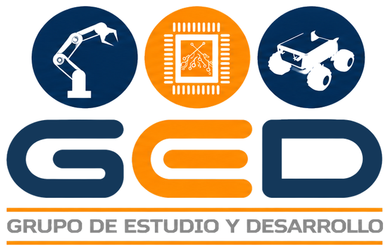

  
  &nbsp;&nbsp;&nbsp;&nbsp;
  
  &nbsp;&nbsp;&nbsp;&nbsp;
  

<h1 align="center">GED · Grupo de Estudio y Desarrollo en Robótica</h1>

  <b>Facultad de Ingeniería Electrónica · Universidad Santo Tomás</b>

  
  

Espacio mantenido por estudiantes del GED con el apoyo de docentes del grupo. No es un canal oficial de la Universidad Santo Tomás.

---

## Sobre el grupo

El **GED** es un grupo de investigación adscrito desde **2003** a la Facultad de Ingeniería Electrónica de la Universidad Santo Tomás, en Bogotá. Trabaja en la investigación y creación de **agentes robóticos inteligentes con fines sociales**, integrando inteligencia artificial, visión por computador, aprendizaje de máquina, electrónica y mecánica.

Está reconocido por **Minciencias en categoría B** y avalado por la Universidad Santo Tomás. Más información en su perfil oficial de [GrupLAC](https://scienti.minciencias.gov.co/gruplac/jsp/visualiza/visualizagr.jsp?nro=00000000002964).

## Líneas de investigación

<table>
  <tr>
    <td align="center" width="33%"><b>Inteligencia Computacional</b></td>
    <td align="center" width="33%"><b>Robótica</b></td>
    <td align="center" width="33%"><b>Visión Artificial</b></td>
  </tr>
</table>

## Trayectoria

| Año | Logro |
|:-:|---|
| 2009 · 2010 · 2011 | Primer lugar en la **IEEE Latin American Robotics Competition** (Brasil) |
| Desde 2011 | Representa a Colombia en **RoboCup** con su equipo de fútbol robótico de la Small Size League |
| 2015 | **Cuarto lugar mundial** en RoboCup Small Size League (Hefei, China) |
| 2019 | **Cuarto lugar mundial** en RoboCup@Home, liga SSPL (Sídney, Australia), con la Alianza SINFONIA |
| 2025 | Participación en **RoboCup@Home**, Open Platform League (Salvador, Brasil), con el equipo **Andesrobot**, junto a la Universidad Andrés Bello (Chile) |

## Proyectos

<table>
  <tr>
    <td>
      <h3><a href="https://github.com/V01D-Szp/Tesis_IL">Tesis_IL</a></h3>
      <b>Estrategia de Aprendizaje por Imitación para la manipulación de objetos con una mano robótica multidedo</b>
       Caso de estudio con objetos del estándar Yale-CMU-Berkeley (YCB)
      
Desarrollo y evaluación de una estrategia de control basada en Aprendizaje por Imitación para el agarre y desplazamiento de objetos con una mano robótica multidedo. Las demostraciones se recolectan mediante teleoperación guiada en simulación y se entrenan políticas ACT (<i>Action Chunking with Transformers</i>) y Diffusion Policy.

      

        
        
        
        
        
      

      <a href="https://github.com/V01D-Szp/Tesis_IL">Repositorio</a> · <a href="https://github.com/V01D-Szp/Tesis_IL/tree/main/docs">Documentación</a>
    </td>
  </tr>
  <tr>
    <td>
      <h3><a href="https://github.com/shdeza12/Collaborative-Mobile-Robot-System-for-Indoor-Navigation-Assistance-in-Multi-Level-Environments">Sistema colaborativo de robots móviles</a></h3>
      <b>Sistema colaborativo de robots móviles para asistencia de orientación en entornos interiores con múltiples pisos</b>
      
Dos robots AWS DeepRacer, uno por piso, guían a una persona dentro de un edificio. El usuario elige su destino desde el celular, el robot de su piso lo lleva hasta la escalera y el robot del otro piso lo recibe y termina el recorrido. Un coordinador central asigna los robots y organiza el relevo entre pisos.

      

        
        
        
        
        
      

      <a href="https://github.com/shdeza12/Collaborative-Mobile-Robot-System-for-Indoor-Navigation-Assistance-in-Multi-Level-Environments">Repositorio</a> · <a href="https://shdeza12.github.io/Collaborative-Mobile-Robot-System-for-Indoor-Navigation-Assistance-in-Multi-Level-Environments/">Sitio del proyecto</a> · <a href="https://youtu.be/X3BINGgNxiA">Video</a>
    </td>
  </tr>
</table>

## Contacto

- **Instagram:** [@ged_santoto](https://www.instagram.com/ged_santoto/)
- **Correo:** [gedsantoto2026@gmail.com](mailto:gedsantoto2026@gmail.com)

---

GED · Facultad de Ingeniería Electrónica · Universidad Santo Tomás

