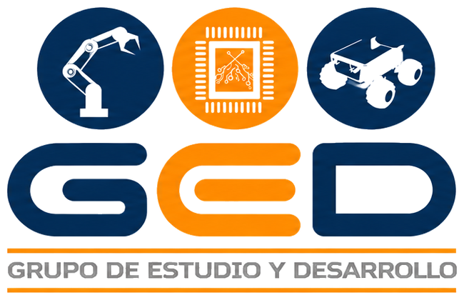
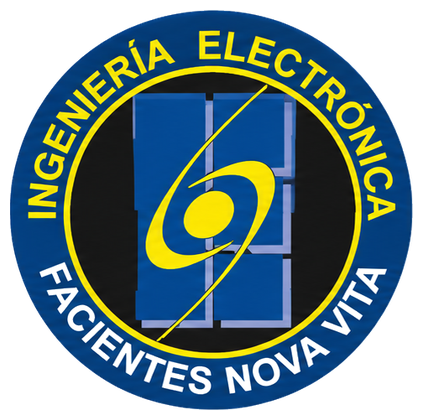

  
  &nbsp;&nbsp;&nbsp;&nbsp;
  
  &nbsp;&nbsp;&nbsp;&nbsp;
  

<h1 align="center">GED · Grupo de Estudio y Desarrollo en Robótica</h1>

  <b>Facultad de Ingeniería Electrónica · Universidad Santo Tomás</b>

  
  

---

## Sobre el grupo

El **GED** es el Grupo de Estudio y Desarrollo en Robótica de la Facultad de Ingeniería Electrónica de la Universidad Santo Tomás. En esta cuenta reunimos los proyectos y trabajos de grado desarrollados por sus integrantes.

## Líneas de trabajo

<table>
  <tr>
    <td align="center" width="33%"><b>Manipuladores robóticos</b></td>
    <td align="center" width="33%"><b>Sistemas embebidos</b></td>
    <td align="center" width="33%"><b>Robótica móvil</b></td>
  </tr>
</table>

## Proyectos

<table>
  <tr>
    <td>
      <h3><a href="https://github.com/V01D-Szp/Tesis_IL">Tesis_IL</a></h3>
      <b>Estrategia de Aprendizaje por Imitación para la manipulación de objetos con una mano robótica multidedo</b>
       Caso de estudio con objetos del estándar Yale-CMU-Berkeley (YCB)
      
Desarrollo y evaluación de una estrategia de control basada en Aprendizaje por Imitación para el agarre y desplazamiento de objetos con una mano robótica multidedo. Las demostraciones se recolectan mediante teleoperación guiada en simulación y se entrenan políticas ACT (<i>Action Chunking with Transformers</i>) y Diffusion Policy.

      

        
        
        
        
        
      

      <a href="https://github.com/V01D-Szp/Tesis_IL">Repositorio</a> · <a href="https://github.com/V01D-Szp/Tesis_IL/tree/main/docs">Documentación</a>
    </td>
  </tr>
</table>

## Contacto

- **Instagram:** [@ged_santoto](https://www.instagram.com/ged_santoto/)
- **Correo:** [gedsantoto2026@gmail.com](mailto:gedsantoto2026@gmail.com)

---

GED · Facultad de Ingeniería Electrónica · Universidad Santo Tomás

