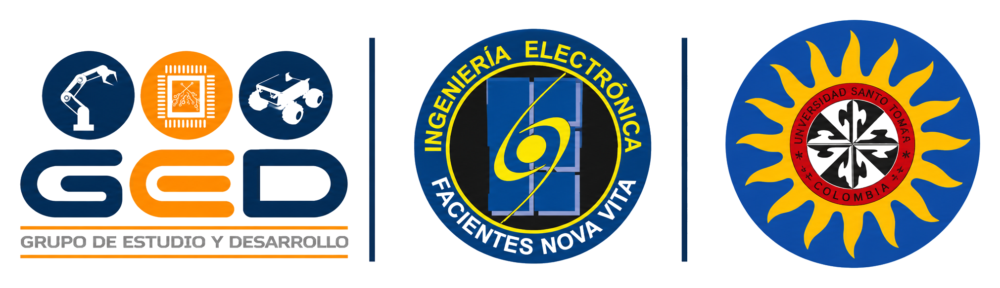
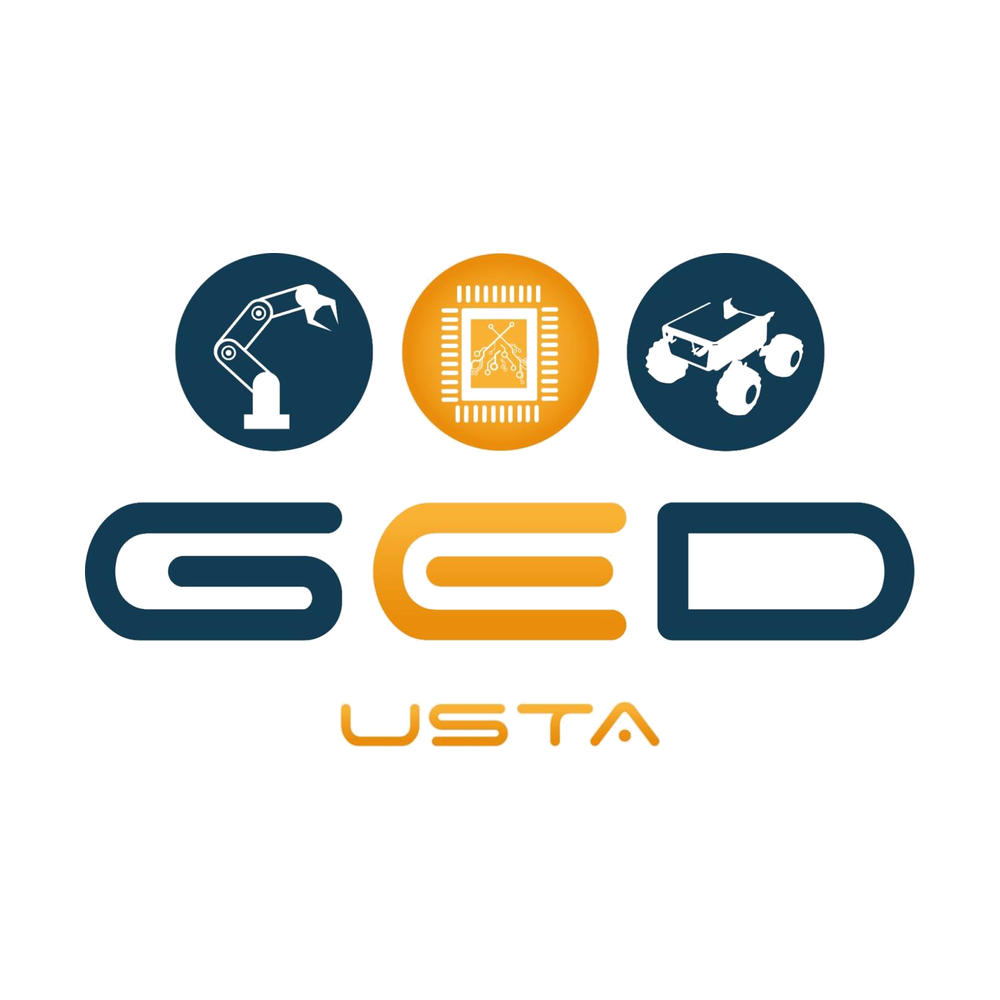
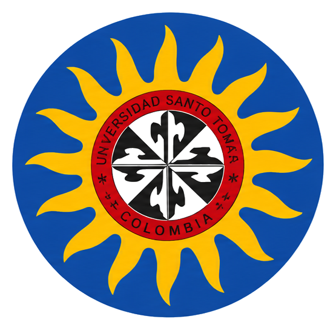
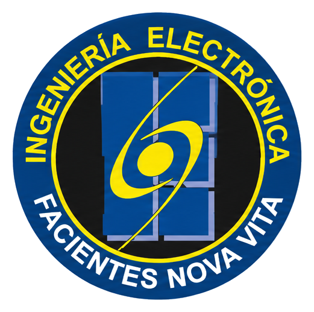
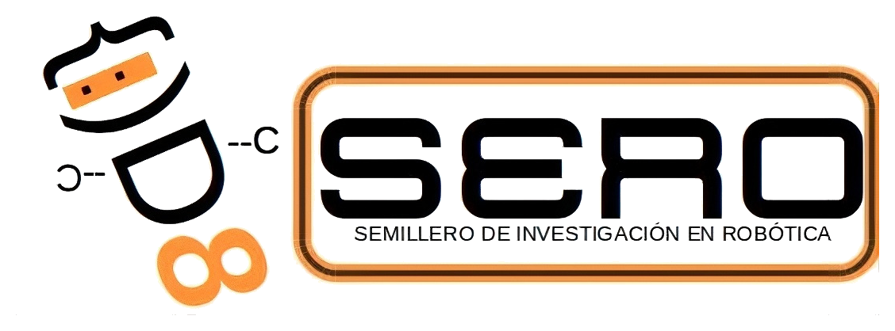

<!-- Encabezado con logos institucionales -->

  

<h1 align="center">Grupo de Estudio y Desarrollo en Robótica 🤖</h1>

  

## <picture></picture> ¿Quiénes somos?

<picture></picture>

- 🏛️ Grupo de la **Facultad de Ingeniería Electrónica** de la **Universidad Santo Tomás**, Bogotá.
- 🤖 Estudiamos, investigamos y desarrollamos proyectos de **robótica**.
- 🎓 Aquí reunimos los **proyectos y tesis** de nuestros integrantes.
- 🤝 Trabajamos de la mano con el semillero **SERO**.
- 📚 Todo nuestro trabajo es abierto, para que otros estudiantes aprendan y aporten.

 

---

## 🔬 Líneas de trabajo

<table align="center">
  <tr>
    <td align="center" width="33%">🦾 <b>Manipuladores robóticos</b> Brazos y manos robóticas, cinemática, control, aprendizaje por imitación</td>
    <td align="center" width="33%">🔌 <b>Sistemas embebidos</b> Microcontroladores, PCB, sensores, firmware</td>
    <td align="center" width="33%">🚙 <b>Robótica móvil</b> Rovers, humanoides, navegación, ROS 2</td>
  </tr>
</table>

---

## 📂 Proyectos

<table>
  <tr>
    <td width="50%" valign="top">
      <h3>🖐️ <a href="https://github.com/V01D-Szp/Tesis_IL">Tesis_IL</a></h3>
      <b>Aprendizaje por Imitación para la manipulación de objetos con una mano robótica multidedo</b> 
      Políticas ACT y Diffusion Policy entrenadas con LeRobot a partir de demostraciones por teleoperación en MuJoCo, evaluadas con objetos del estándar YCB.  
      
      
      
      
      
       👤 <a href="https://github.com/V01D-Szp">@V01D-Szp</a>
    </td>
    <td width="50%" valign="top">
      <h3>🦿 <a href="https://github.com/50DIEGO04/Tesis_Unitree">Tesis_Unitree</a></h3>
      <b>Tesis con el robot humanoide Unitree G1</b> 
      <!-- EDITAR: describe en una o dos líneas el objetivo de la tesis --> Desarrollo de trabajo de grado sobre la plataforma humanoide Unitree G1.  
      
      
      
       👤 <a href="https://github.com/50DIEGO04">@50DIEGO04</a>
    </td>
  </tr>
  <tr>
    <td width="50%" valign="top">
      <h3>🤖 <a href="https://github.com/Unitree-SERO/unitree-g1-sero">unitree-g1-sero</a></h3>
      <b>Desarrollo con el humanoide Unitree G1 · GED + SERO</b> 
      <!-- EDITAR: describe en una o dos líneas qué hace este repositorio --> Proyecto conjunto con el semillero SERO sobre el robot Unitree G1.  
      
      
       👥 <a href="https://github.com/Unitree-SERO">@Unitree-SERO</a>
    </td>
    <td width="50%" valign="top" align="center">
      <h3>➕ ¿Tu proyecto?</h3>
      Si eres integrante del GED y tienes un proyecto o tesis, avísanos para agregarlo aquí.
    </td>
  </tr>
</table>

---

## 👥 Integrantes

<!-- Agrega una fila por integrante. La foto sale sola desde GitHub. -->

  
  

---

## 🛠️ Tecnologías

  

---

## 🤝 Aliados

  
  &nbsp;&nbsp;&nbsp;
  
  &nbsp;&nbsp;&nbsp;
  

---

## 📫 Contacto

  <!-- EDITAR: reemplaza con el correo y redes reales del grupo -->
  
  
  

  

Hecho con 🧡 por el GED · Facultad de Ingeniería Electrónica · Universidad Santo Tomás

